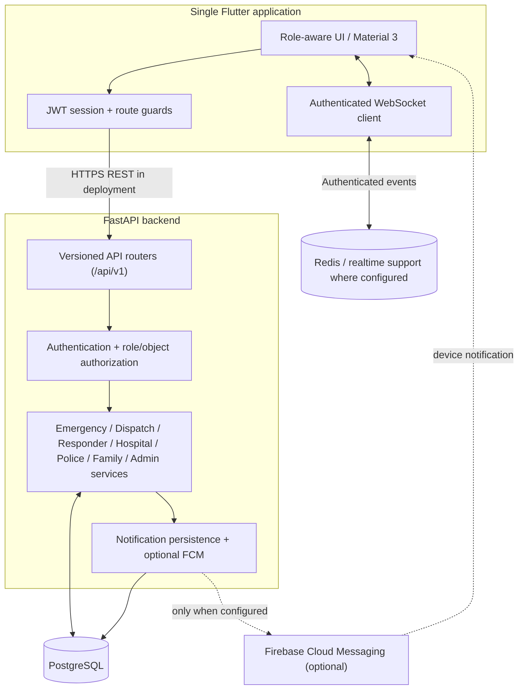
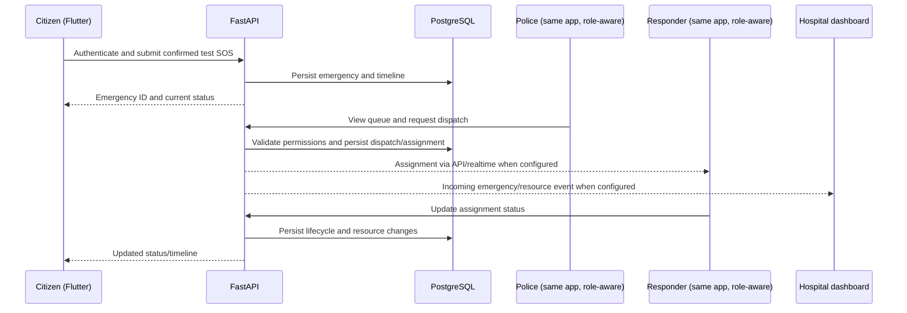

# LifeLink AI — Architecture and Demo Data Flow

This diagram documents the existing intended architecture at the project level. It does not imply that every external integration (Firebase, maps, GPS, or live deployment) is configured in every environment.

## High-level architecture

## Emergency demo sequence

## Trust boundaries and data ownership

- The Flutter app is one client with separate role-aware routes; roles are not separate applications.
- FastAPI is the authority for authentication, authorization, emergency state, dispatch state, and hospital-resource updates.
- PostgreSQL stores persistent domain state. The client must not treat a local UI state or WebSocket event as the authoritative record.
- Realtime events improve responsiveness; clients should reload/synchronize from the API after reconnecting.
- Notifications are persisted by the backend. FCM is optional and must be separately configured and tested.
- Location permission is explicit. Do not request background location for the current foreground SOS flow.
- Use synthetic demo accounts and test coordinates. Never put secrets or real emergency/patient data into the repository.

## API and local endpoints

- Local FastAPI documentation: `http://127.0.0.1:8000/docs`
- Local API prefix: `/api/v1`
- Flutter web local API base: `http://127.0.0.1:8000/api/v1` (CORS must allow the chosen local web origin).
- Android emulator API base: `http://10.0.2.2:8000/api/v1`.

See the root README and `Doc/DAY7_DEMO_RELEASE_CHECKLIST.md` for setup and release evidence requirements.
